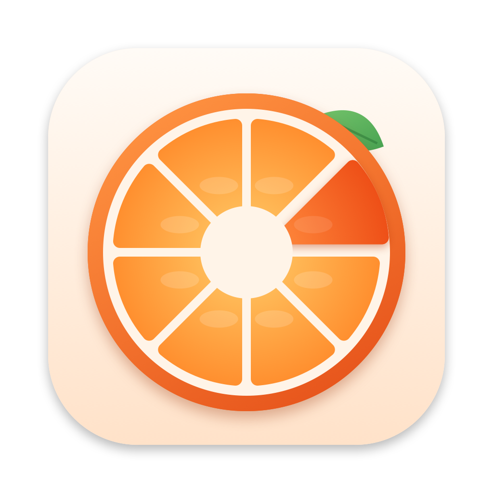

# Tangelo

Hold **⇧ Shift** while dragging any file, and a ring opens around your cursor. Drop the file on a
format or a tool, and the result is saved right next to the original. Everything runs on your Mac;
nothing is uploaded.

It's a native macOS rebuild of the drag + Shift converter idea (Tangerine) from the reel.



## Using it

1. Start dragging a file (or several) from Finder, the Desktop, Photos, Mail…
2. Hold **⇧ Shift**: the ring appears around your cursor.
3. Drop on a wedge. A small panel shows progress, then **Show** reveals the result.

- **Switch pages** (Convert · More · Tools · Extras / Merge): hover the tabs under the ring, or tap Shift again.
- **Wedges with `•••`** (Compress, Rotate, Resize, Speed) open a sub-ring when you pause on them.
  Dropping on them directly uses the default (e.g. Balanced compression). Pause in the center to go back.
- **Cancel**: drop in the middle of the ring, or move away and drop somewhere else.
- **No drag?** Use the menu bar icon → *Convert Files…* and click a wedge instead.
- Outputs never overwrite anything: `Photo.heic` becomes `Photo.jpg`, `Photo Cropped.jpg`, `Photo 2.jpg`, and so on.

The menu bar icon (a citrus slice) has **Recent** files, an on/off switch, **Settings**
(trigger key, output folder, quality, launch at login) and the welcome guide.

## What it can do

| Files | Convert to | Tools |
|---|---|---|
| **Images** (JPG, PNG, HEIC, WebP, AVIF, TIFF, GIF, BMP, SVG, RAW, PSD, ICO…) | JPG · PNG · HEIC · WebP · AVIF · PDF · TIFF · GIF · BMP · ICO · ICNS · JPEG 2000 · PSD · TGA · TXT/DOCX (text recognition) · MP4 (from GIF) | Compress (light/balanced/strong) · Crop · Edit (exposure, contrast, warmth, filters, rotate) · Annotate (arrows, boxes, text, steps, pen, highlighter) · Add BG (gradient backgrounds, padding, corners, shadow) · Redact (black/pixelate/blur + find text/faces) · Metadata (view, remove location/all) · Remove background · Resize · Rotate/flip · Grayscale · Copy text |
| **Several images** | each of the above | Combine into PDF · Animated GIF · Stitch vertically/horizontally · Zip |
| **PDF** | JPG · PNG · HEIC · TIFF · WebP · AVIF (one image per page) · DOCX · DOC · RTF · ODT · HTML · Markdown · TXT | Compress · Merge · Split pages · Rotate · OCR (make scanned PDFs searchable) · Protect/Unlock with password · Copy text · Word count |
| **Video** (MOV, MP4, M4V, MKV, WebM, AVI…) | MP4 · MOV · M4V · HEVC · ProRes · WebM · MKV · AVI · GIF · audio (M4A, MP3, WAV, FLAC, AIFF, AAC, Opus) | Trim · Compress · Mute · Rotate · Resize (480p–4K) · Speed (0.5×–4×) · Snapshot frame · Merge clips |
| **Audio** (MP3, M4A, WAV, AIFF, FLAC, OGG, Opus…) | MP3 · M4A · WAV · AIFF · FLAC · ALAC · Opus · OGG · CAF · AAC · iPhone ringtone · AC3 · WMA | Trim · Compress · Normalize · Mono · Reverse · Speed · Merge |
| **Documents** (DOCX, DOC, RTF, TXT, HTML, ODT, Markdown, source code) | PDF · DOCX · DOC · RTF · RTFD · TXT · HTML · ODT · Markdown · Web archive | Merge into PDF · Word count · Copy text |
| **Data** (CSV, TSV, JSON, XLSX) | CSV · TSV · JSON · XLSX · HTML table · Markdown table | Prettify/minify JSON |
| **Archives & folders** | Zip · TAR.GZ | Extract (zip, tar, gz, 7z…) |

Most of this uses Apple's own frameworks (ImageIO, PDFKit, AVFoundation, Vision, Core Image).
**ffmpeg** (already on this Mac via Homebrew) adds MP3, WebM, MKV, AVI, Opus, OGG, AC3, WMA and reading
MKV/WebM. WebP is written by Tangelo's own lossless encoder; install `cwebp` (`brew install webp`) to get
smaller lossy WebP files too.

## First-run notes

- macOS asks once for access to Desktop/Documents/Downloads the first time Tangelo saves a result
  there. Click **Allow**.
- No Accessibility or Screen Recording permission is needed. Tangelo watches mouse clicks and drags
  only, never keystrokes.
- To start Tangelo automatically, turn on **Open Tangelo at login** (welcome window or Settings).

## Building

```bash
git clone https://github.com/Tutoff/Tangelo.git && cd Tangelo
make install   # build, copy to ~/Applications/Tangelo.app and launch
make test      # WebP encoder round-trips + ~400 end-to-end conversion checks
make qa        # deep QA: checks every result is correct (see below)
```

Building needs Xcode 26 or its Command Line Tools (`xcode-select --install`): Swift 6 and the macOS 26 SDK.
A copy built this way opens without Gatekeeper warnings. The app runs on macOS 15+; on macOS 26 the ring,
buttons, pickers and progress panel use Liquid Glass, and older systems get the frosted Core Graphics version.

There's also a command-line runner:

```bash
build/tangelo-cli menu ~/Desktop/photo.heic              # list the ring's actions for a file
build/tangelo-cli run image.to.jpg ~/Desktop/photo.heic  # run one
```

### Quality checks

`tangelo-cli qa [folder]` generates sample files (photos with EXIF/GPS, an iPhone-style rotated JPEG,
SVG, GIF, multi-page and scanned PDFs, audio, a rotation-flagged video, WebM, documents, CSV/JSON, ZIP),
runs every action on every file and checks that the *result* is right, not just that a file appeared:
pixel orientation after rotate/flip, exact sizes, visual similarity, codecs and durations, displayed
video size, PDF page rotation and page counts, recognized text, audio channels/peak/reversal, and
lossless round-trips for data files.

App-side checks (run against the app binary):

| Command | What it checks |
|---|---|
| `Tangelo --self-test <folder>` | ~6,400 scripted checks over 12 scenarios (single/multiple images, PDF, video, audio, documents, CSV, JSON, ZIP, folders, mixed): every page, wedge, gap, sub-ring, tab, Shift-tap, drop, cancel path and click-mode action; plus the glass ring's lifecycle. `TANGELO_SELFTEST_ONLY=<scenario>` runs one. |
| `Tangelo --leak-test <folder>` | every tool window and progress panel is freed after closing; heap stays flat on reopen |
| `Tangelo --mem-test <folder>` | memory footprint through a typical session (ring, jobs, tool windows) |
| `Tangelo --render-ring out.png …`, `--render-tool crop file out.png`, `--render-welcome out.png` | offscreen renders for visual review |

Job activity is logged to the unified log:

```bash
log stream --predicate 'subsystem == "app.tangelo.mac"'
```

### Layout

```
Sources/TangeloCore   conversion engine (images, WebP encoder, PNG quantizer, PDF, audio/video,
                      documents, Markdown, CSV/JSON/XLSX, archives, Vision, action catalog, runner)
Sources/Tangelo       the menu bar app: drag detection, the ring, progress HUD, tool windows, settings
Sources/TangeloCLI    command-line runner and the test suite
scripts/              build.sh, make_icon.swift
```

## Uninstalling

Quit Tangelo from its menu, delete `~/Applications/Tangelo.app`, and optionally run
`defaults delete app.tangelo.mac`. Turn off the login item first if you enabled it.
